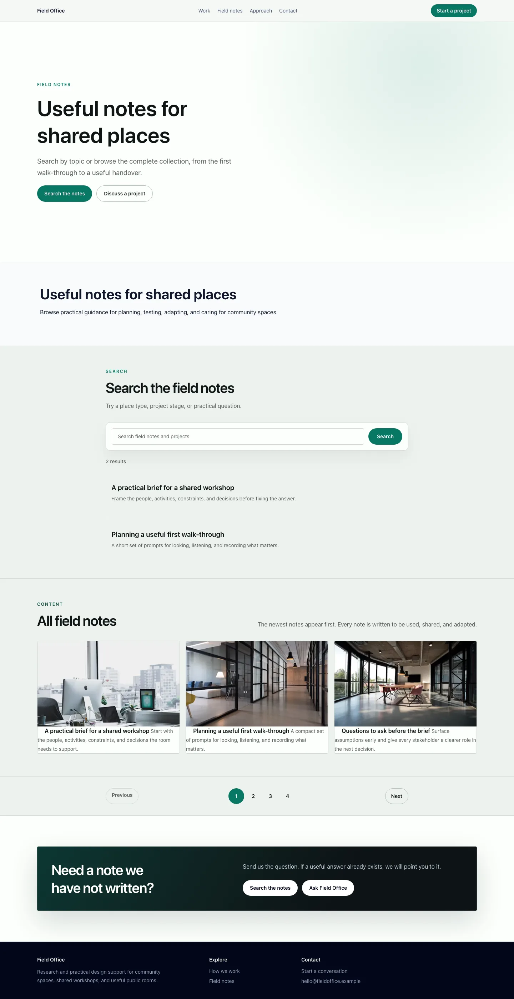
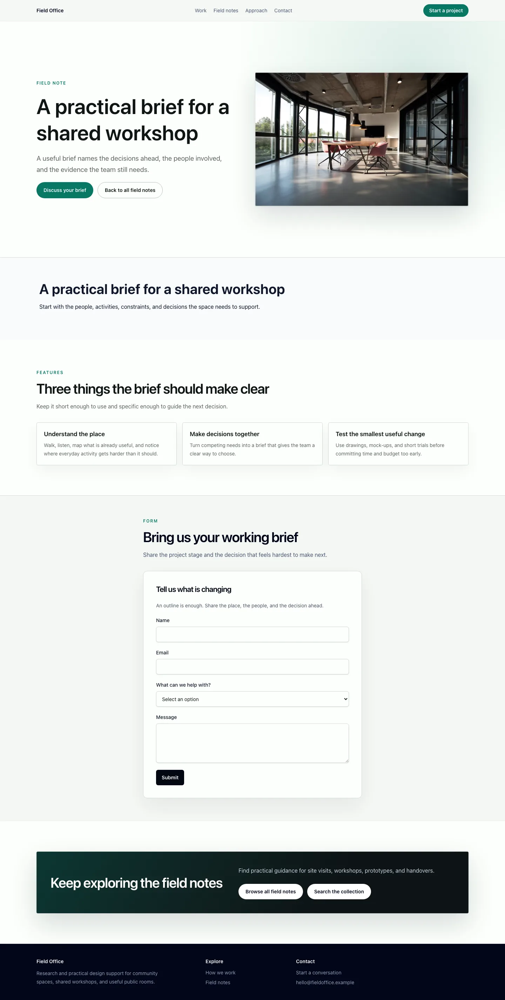

# Foundation Theme

<!-- prettier-ignore-start -->

## What It Does

Theme Foundation provides the shared public layouts, runtime design tokens, layout defaults, and override contracts used by Capell themes. It renders host-owned page data and does not introduce a separate content model.

- **Price and availability:** Check current availability and price on the [Capell Marketplace listing](https://capell.app/extensions/theme-foundation).
- **Licence:** Check the licence terms on the [Capell Marketplace listing](https://capell.app/extensions/theme-foundation).
- **Requires:** `PHP ^8.4`, `capell-app/admin ^1.0.66`, `capell-app/core ^1.0.75`, `capell-app/frontend ^1.0.72`, `capell-app/layout-builder ^1.0`, `capell-app/navigation ^1.0`, `lorisleiva/laravel-actions ^2.8`, `spatie/laravel-data ^4.0`, `spatie/laravel-package-tools ^1.0`.
- **Install:** `composer require capell-app/theme-foundation`.

Use Preview Foundation Theme on existing content before Apply Foundation Theme, which changes the selected site's public design; reapply its previous theme to restore that selection. Shared Theme Studio settings saves can affect public pages. For fictional demo content, name a disposable target with --site and review --base-url and --language; unscoped setup refuses existing sites, scoped repeats preserve site configuration unless --force deliberately replaces its theme, enabled state, requested site translations and domains, while demo pages, widgets and demo layouts are rewritten on scoped repeats.

## Who It Is For

**For developers:** The package centralizes theme registration, token resolution, layout defaults, and public-output safety contracts for the theme fleet.

**For teams:** Teams get a consistent baseline for site chrome, layout behaviour, and design settings across Capell themes.

## Quick Start

1. Install the package: `composer require capell-app/theme-foundation`.
2. Run the package setup: `php artisan capell:theme-foundation-setup`.
3. See it working on a disposable site: run `php artisan capell:theme-foundation-demo --site="Theme demo"`. Choose a new site name for your demo; keep customer sites for the Preview → Apply workflow above.
4. Run `php artisan list` and verify the package command signatures are registered.

## Configure

- **Configuration files:** `config/capell-theme-foundation.php`.
- **Admin settings:** `Capell\FoundationTheme\Settings\FoundationThemeSettings`.
- **Commands:** `php artisan capell:frontend-tailwind-assets`, `php artisan capell:make-foundation-theme`, `php artisan capell:theme-catalogue-report`, `php artisan capell:theme-foundation-demo`, `php artisan capell:theme-foundation-setup`, `php artisan capell:validate-themes`.

## Limits And Pitfalls

- Install the required Capell packages at the versions in `composer.json`: `capell-app/admin ^1.0.66`, `capell-app/core ^1.0.75`, `capell-app/frontend ^1.0.72`, `capell-app/layout-builder ^1.0`, `capell-app/navigation ^1.0`.
- Keep public Blade and cached HTML free of authoring markers, model IDs, permissions, signed editor URLs, and lazy database queries.
- Custom write integrations must preserve invalidation for `theme-foundation` cache tags.

## Screens And Workflow

- Foundation Homepage (frontend).
- Foundation Directory (frontend).
- Foundation Detail Article (frontend).
- Foundation Contact (frontend).
- Foundation Empty State (frontend).
- Foundation Page Not Found (frontend).
- Foundation Call To Action (frontend).
- Foundation Chrome Homepage (frontend).

## Child Theme Override Contract

Foundation Theme owns the stable child theme override surface for Capell themes. Child themes should declare `extends: 'default'` and override documented sections, views, tokens, and chrome areas instead of replacing the whole public rendering path.

Stable contract points:

- Theme Studio sections: `navigation`, `hero`, `features`, `proof`, `content-listing`, `search`, `pagination`, `form`, `contact-split`, `cta`, `footer`.
- Shared views: `capell::theme.page`, `capell::layout.area`, `capell::media.svg`.
- Runtime tokens: `--foundation-page-bg`, `--foundation-section-spacing`, `--foundation-widget-gap`.
- Layout Builder chrome areas: `header`.
- Public-output rule: child themes must not expose authoring metadata, editor controls, model IDs, field paths, permissions, or signed editor URLs.

## Install Impact

- Required packages: `capell-app/admin`, `capell-app/core`, `capell-app/frontend`, `capell-app/layout-builder`, `capell-app/navigation`.
- Admin navigation: no admin page or resource contribution is declared.
- Admin/editor extensions: none declared.
- Permissions: no package permission declarations or Shield gates detected; host access rules still apply.
- Public routes: none declared.
- Database changes: no package migrations declared.
- Config: `config/capell-theme-foundation.php`.
- Settings: `Capell\FoundationTheme\Settings\FoundationThemeSettings`.
- Queues or schedules: none declared.
- Cache tags: `theme-foundation`.
- Commands: `capell:frontend-tailwind-assets`, `capell:make-foundation-theme`, `capell:theme-catalogue-report`, `capell:theme-foundation-demo`, `capell:theme-foundation-setup`, `capell:validate-themes`.

## Troubleshooting

| Symptom | Likely cause | Check | Fix |
| --- | --- | --- | --- |
| Package surface is missing after install | Provider or manifest is not loaded | Confirm `capell.json`, package `composer.json`, and provider registration | Reinstall the package, refresh Composer autoload, and clear host caches |
| Public output leaks unexpected state | Render data, cache variation, or authoring boundary has regressed | Check public Blade, cache tags, and public-output safety tests | Move data loading out of Blade and rerun the package public-output tests |

## Upgrading

No manual steps between minor versions.

Read [CHANGELOG.md](CHANGELOG.md) before upgrading.

## Next Steps

- [Package docs](docs/README.md)
- [Overview](docs/overview.md)
- [Worked extension examples](docs/extension-contracts.md)
- Configuration files: [`config/capell-theme-foundation.php`](config/capell-theme-foundation.php).
- [Troubleshooting](#troubleshooting)
- [Developer reference](docs/reference.md)
- [Marketplace assets](docs/assets/marketplace/)
- [Capell content language plan](../../docs/CONTENT_LANGUAGE_PLAN.md)
- [Capell documentation design system](../../docs/DESIGN_SYSTEM.md)
- [Capell and package ERD notes](../../docs/erd/capell-and-package-erds.md)
- Related packages: [Layout Builder](../layout-builder/README.md), [Navigation](../navigation/README.md).

<!-- prettier-ignore-end -->
